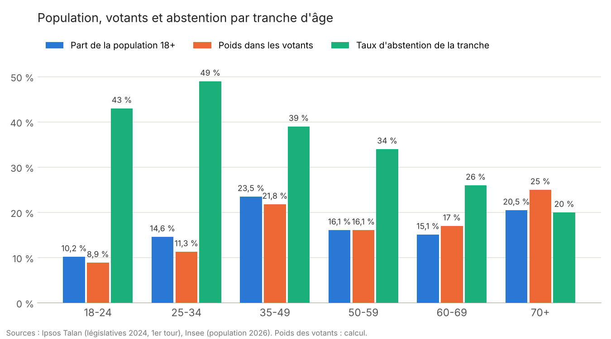
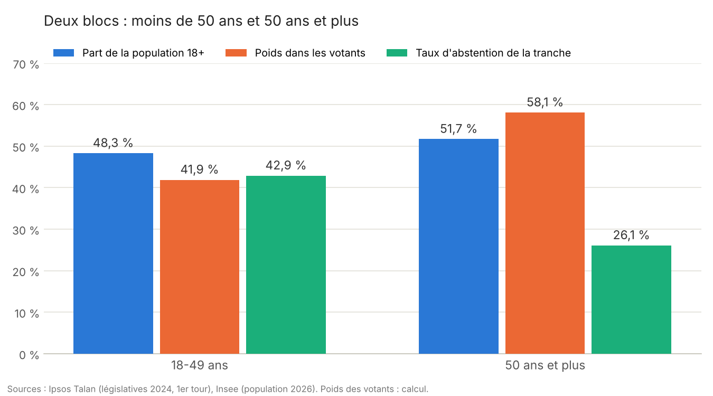

+++
title = "Du vote selon l'âge"
date = 2026-10-24T10:00:00
tags = ["politique", "démographie", "démocratie", "élections"]
slug = "du-vote-selon-age"
draft = false
+++

L'autre soir, je suis parti d'une question toute bête : qui vote quoi, selon l'âge ? Le dernier scrutin national exploitable, ce sont les législatives de 2024 : l'enquête Ipsos Talan du premier tour, croisée avec la pyramide des âges de l'Insee.

Le premier tableau est assez connu. Le **Nouveau Front Populaire** fait 48 % chez les 18-24 ans et 18 % chez les plus de 70 ans. **Ensemble** suit exactement la courbe inverse, et n'arrive en tête que chez les 70 ans et plus (32 %). Le **RN**, lui, est devant de 35 à 69 ans, avec un pic à 40 % chez les 50-59 ans. Jusque-là, rien de très neuf.

Ensuite j'ai voulu savoir combien pèse vraiment chaque tranche dans les urnes. Il faut croiser deux choses : la part de la population, et la participation. Or elle varie énormément : 51 % chez les 25-34 ans, 80 % chez les 70 ans et plus.

En regroupant en deux blocs, ça donne ça :

Les 50 ans et plus sont à peine majoritaires dans la population. Dans les urnes, ils font six électeurs sur dix.

Ce qui compte, ce n'est pas l'écart entre les deux groupes, c'est l'écart de chacun à la moyenne. La participation moyenne est de 66 %. Les moins de 50 ans votent à 0,87 fois la moyenne, les plus de 50 ans à 1,12 fois. Leurs poids sont multipliés d'autant : 48 × 0,87 ≈ 42 et 52 × 1,12 ≈ 58. Les dix-sept points se partagent de part et d'autre du milieu. Et l'abstention grossit visuellement l'effet : 43 % contre 26 %, ça a l'air énorme. Mais en participation, 57 % contre 74 %, c'est déjà moins spectaculaire.

Bref, si tu as moins de 35 ans et que tu trouves que la politique ne te ressemble pas, il y a une piste assez simple. Elle tient dans une enveloppe.

---

*Sources : Ipsos Talan pour France Télévisions, Radio France et Public Sénat, [Sociologie des électorats et profil des abstentionnistes, législatives 2024](https://www.ipsos.com/sites/default/files/ct/news/documents/2024-06/ipsos-talan-sociologie-electorats-legislatives-30-juin-rapport-complet.pdf) (10 286 inscrits, 27-28 juin 2024) ; Insee, [population par âge au 1er janvier 2026](https://insee.fr/fr/statistiques/2381474). Le poids des votants est un calcul : part de la population × participation, ramené à 100 %.*
